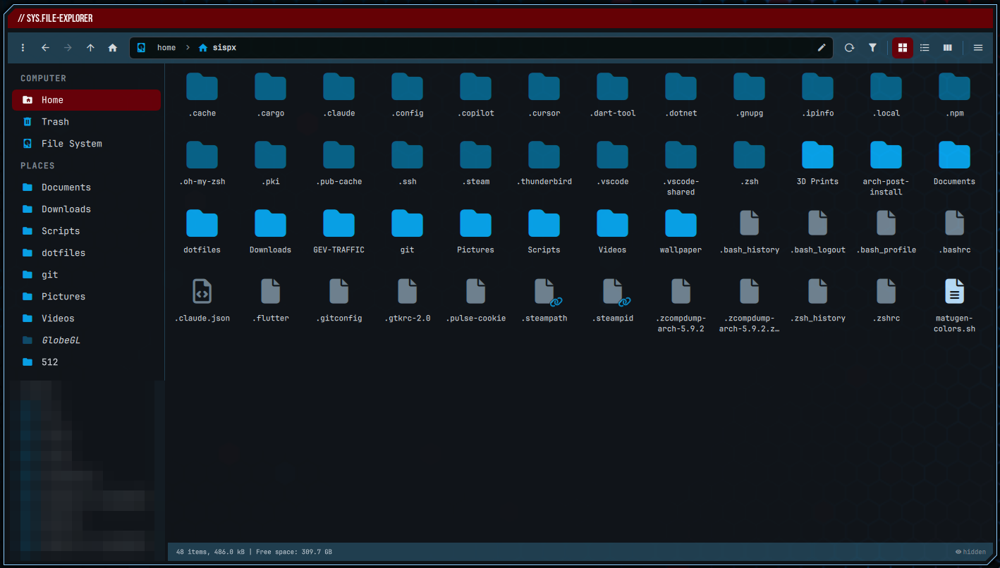

# 3LA File Explorer

A Thunar-style file manager for Linux, written in Rust with a Qt 6 / QML UI
(via [cxx-qt](https://github.com/KDAB/cxx-qt)). Files and folders are drawn
with **JetBrainsMono Nerd Font** glyphs, and the whole UI follows your
[matugen](https://github.com/InioX/matugen) palette live.



> **About the code:** roughly 70% of this project is hand-written. I used
> Claude AI to enhance and tidy up some areas. To be fair, I couldn't figure
> out the encryption feature myself, so I largely handed that part off to AI.

## Requirements

| | Arch package | Needed for |
|---|---|---|
| Rust ≥ 1.88 | `rust` / `rustup` | building |
| Qt 6 (base, declarative, svg, multimedia) | `qt6-base qt6-declarative qt6-svg qt6-multimedia` | the UI, video preview |
| C++ compiler | `base-devel` | the Qt glue in `cpp/` |
| GIO | `glib2` | open with / default apps, gvfs mounts |
| udisks2 | `udisks2` | mount / unmount / eject drives |
| lsblk | `util-linux` | device list |
| Nerd Font | `ttf-jetbrains-mono-nerd` | all icons and text |

Optional:

| Arch package | Enables |
|---|---|
| `libarchive` | extract / compress (`bsdtar`) |
| `smbclient` | SMB network browsing (`smbclient`, `nmblookup`) |
| `gvfs-smb` | mounting SMB shares |
| `libsecret` | saving SMB passwords in the keyring (`secret-tool`) |
| `ffmpeg` | video thumbnails |
| `matugen` | live theming (a built-in dark palette is used otherwise) |

Developed and tested on Arch Linux with Qt 6.12; other distributions should
work with the equivalent packages.

## Build & install

```sh
git clone https://github.com/ne0tt/3LA-FileExplorer.git
cd 3LA-FileExplorer
cargo run --release -- ~/some/folder   # try it; the start folder is optional
./install.sh                           # install for the current user
```

`install.sh` builds a release binary and installs:

- `~/.local/bin/3la-fileexplorer`
- `~/.local/share/applications/3LA-FileExplorer.desktop`
- the matugen template, if `~/.config/matugen/templates/` exists

To make it the default folder handler:

```sh
xdg-mime default 3LA-FileExplorer.desktop inode/directory
```

## Usage

```sh
3la-fileexplorer [location]
```

`location` can be a path (`~` is expanded), `trash:///`, `network:///` or an
`smb://host[/share[/path]]` URI. Without one it opens your home folder.

Press **F1** in the app for the keyboard shortcuts.

## Theming (matugen)

The palette has two parts:

- **Wallpaper colours.** Backgrounds, text, borders, the toolbar and the file
  icons use the Material 3 roles matugen generates from your wallpaper, so
  they change every time the wallpaper does.
- **Custom accent colours.** Highlights use two fixed colours that you choose,
  defined in matugen's `[config.custom_colors]`. They stay the same whatever
  the wallpaper, which gives the app a recognisable signature colour on top
  of the generated scheme.

| Colour | Used for |
|---|---|
| `accent` | selected files (solid when focused, 55% opacity otherwise), the current menu item, checked toolbar buttons, the active place in the side pane, text selection, dialog buttons and title bars |
| `accent2` | drag-and-drop targets, the "fair" step of the password-strength meter |

Text drawn on top of `accent` is black or white automatically, whichever
contrasts better, so any colour works: dark or light.

### Setup

Add both colours and the template to `~/.config/matugen/config.toml`:

```toml
[config.custom_colors]
accent = { color = "#690005", blend = false }
accent2 = { color = "#b38000", blend = false }

[templates.3la-fileexplorer]
input_path = '~/.config/matugen/templates/3la-fileexplorer-colors.json'
output_path = '~/.config/3la-fileexplorer/colors.json'
```

- `color` is the colour you want, in hex. The values above are the defaults
  (deep red and amber); pick your own.
- `blend = false` keeps the colour exactly as written. With `blend = true`,
  matugen shifts its hue towards the wallpaper colour, so the accent changes
  slightly with every wallpaper.
- The template reads `accent_source` / `accent2_source`, the colour itself
  rather than one of the tonal variants matugen also generates for it.
- Both entries are required: if either is missing, matugen can't render the
  template.

The app watches `colors.json` and recolours instantly: no restart, no hook.
Without a `colors.json` it falls back to a built-in dark palette that uses the
same default accents. The role → UI mapping lives in `qml/Theme.qml`.

## Features

**Browsing**
- Icon, detailed list (sortable, resizable, configurable columns) and compact
  views, with zoom
- Tabs (middle-click a folder, crumb or place to open it in a new tab) and new windows
- Side pane: places, removable and internal drives (mount / unmount / eject
  via udisks, usage bars), network mounts, bookmarks
- Path bar that remembers deeper crumbs; Ctrl+L for an editable location with
  Tab completion
- Filter the current folder (Ctrl+F), show hidden files (Ctrl+H), live
  updates when folders change
- View mode, sort order and zoom remembered per folder
- Picture and video thumbnails (freedesktop thumbnail cache first, then a
  direct decode or ffmpeg frame grab); Space opens a quick preview

**File operations**
- Copy / cut / paste that interoperates with Thunar, Nautilus and Dolphin
- Background jobs with progress, ETA, cancel and queueing; replace / skip /
  keep-both conflict handling; moves across filesystems
- Drag & drop between views, tabs, the side pane, crumbs and other apps (move
  on the same filesystem, copy across; Ctrl copies, Ctrl+Shift links)
- Undo the last copy, move, rename, trash or create (Ctrl+Z)
- Trash: browse, restore, delete, empty; permanent delete with confirmation
- Create folders, empty files and documents from `~/Templates`; make link; duplicate
- Rubber-band and Ctrl / Shift selection, type-ahead find, select by pattern,
  invert selection

**Integration**
- Open with the default app, an Open With menu, and a chooser with a custom
  command and "set as default"
- Properties: type, size (computed in the background), dates, free space,
  owner / group, permission editing (optionally recursive)
- Archives: Extract Here, or compress to zip / tar.gz / tar.xz / tar.zst / tar
- Password encryption in the [age](https://age-encryption.org) format: a file
  becomes `<name>.age`, a folder is locked into a `VAULT` file. Both can be
  decrypted with the standard `age -d` tool
- SMB network browsing: host discovery, share lists, mounting through gvfs,
  with optional keyring-saved passwords
- Open a terminal here (F4; uses `$TERMINAL`, otherwise the first of kitty,
  foot, alacritty, wezterm, konsole, xfce4-terminal, gnome-terminal, xterm)
- Send To desktop or drives

**Preferences**: default view, grid spacing, folders first, hidden files,
thumbnails, font sizes, row stripes, dialog style, date format (presets,
relative or custom), single-click activation, tab bar, trash confirmation.

## Configuration files

Everything lives in `~/.config/3la-fileexplorer/`:

| File | Contents |
|---|---|
| `settings.conf` | preferences and window state |
| `bookmarks` | side-pane bookmarks (GTK format; imported once from `~/.config/gtk-3.0/bookmarks`) |
| `folders.json` | per-folder view settings |
| `colors.json` | the palette written by matugen |

## Project layout

| Path | Purpose |
|---|---|
| `src/bridge/folder_model.rs` | `FolderModel`: list model, background listing, inotify updates, trash view |
| `src/bridge/file_ops.rs` | `FileOps`: job queue, worker thread, conflicts, undo |
| `src/bridge/system.rs` | `Sys`: apps, clipboard, bookmarks, devices, theme watching, properties |
| `src/fsutil.rs`, `src/icons.rs`, `src/apps.rs` | stat / sort / format helpers, Nerd Font icon map, `.desktop` / `gio` integration |
| `src/config.rs` | config paths, one-time migration, per-folder view store |
| `src/archive.rs`, `src/crypt.rs` | archive handling (`bsdtar`), age encryption of files and folder vaults |
| `src/smb.rs` | SMB discovery, share listing, gvfs mounting, keyring credentials |
| `src/trashdir.rs` | trash listing that avoids triggering automounts |
| `cpp/native.cpp` | clipboard formats, MIME database, theme-icon and thumbnail image providers |
| `qml/` | the UI: `Main.qml`, `BrowserPane.qml`, views, side pane, `Spx*` dialog kit, `T*` themed controls |
| `fonts/` | Chakra Petch, the dialog title font (embedded in the binary) |
| `data/`, `matugen/` | `.desktop` entry template, matugen colour template |

Run the tests with `cargo test`.

## Roadmap

Not implemented yet: split view, tree side pane, recursive search, bulk
rename, custom actions, LUKS unlock, PDF thumbnails, tab drag-reorder.

## Credits

- [Chakra Petch](https://github.com/m4rc1e/Chakra-Petch) © The Chakra Petch
  Project Authors, under the SIL Open Font License 1.1 (`fonts/OFL.txt`)
- Icons from [Nerd Fonts](https://www.nerdfonts.com)
